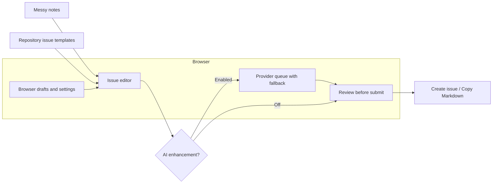

# IntakePad

<p align="center">
  <a href="LICENSE"></a>
  
  
  
  <a href="https://github.com/tinydarkforge/IntakePad/actions/workflows/deploy.yml"></a>
  <a href="https://tinydarkforge.github.io/IntakePad/"></a>
</p>

**IntakePad turns messy notes into clean GitHub issues.** It loads a repository's own issue templates, drafts in the browser, optionally cleans the text with AI through a provider queue, and creates the issue on GitHub or copies the Markdown.



No backend and no account. Settings, drafts, and keys stay in your browser's `localStorage`.

**Who it's for** — maintainers, triagers, and developers who turn raw notes, logs, or Slack threads into GitHub issues and want the draft to follow the target repository's own templates. No server to run, no team account to provision, no keys stored outside your browser.

### Why IntakePad

| Instead of | IntakePad gives you |
|------------|---------------------|
| GitHub's web issue form | Paste messy notes, get a template-aware draft, and create the issue from the same screen. |
| A generic AI chat | Repo templates, an ordered provider queue with fallback, and review + undo before anything is submitted. |
| A hosted tool with a backend | A static site: tokens and drafts stay in your browser's `localStorage`, and copy-only mode needs no token at all. |

---

## Quick start

```bash
npm ci
npm run dev
```

Open http://localhost:3000, or use the [hosted app](https://tinydarkforge.github.io/IntakePad/).

```bash
npm test        # node:test + TypeScript, no runtime dependencies added
npm run lint
npm run build   # static export → ./out
```

Those three commands are the same gate CI runs before publishing.

---

## How it works

IntakePad reads a repository's own `.github/ISSUE_TEMPLATE/` files through the GitHub REST API, so drafts match the format the team already uses. Paste unstructured text, optionally enhance it with AI, review what changed, then create the issue or copy the Markdown. Nothing is submitted without your click.

**Templates from the repo** — real issue templates are loaded via the GitHub API, with a blank-issue fallback and copy-only mode when no repository is configured.

**AI enhancement with provider queue** — configure multiple providers; IntakePad tries them in priority order and falls back automatically. Local models, free tiers, and cloud providers are supported.

**Review before anything ships** — the review bar shows what the AI changed, what is missing, and which provider handled the draft. Undo restores the original text in one click.

**Local drafts** — autosaved per repository and template, restored on return.

### Default provider order

| Priority | Provider | Type | Key needed | Note |
|----------|----------|------|------------|------|
| 1 | Local (Ollama) | local | No | Privacy-first, works offline |
| 2 | Local (LM Studio) | local | No | Privacy-first, works offline |
| 3 | Anthropic | cloud | Yes | |
| 4 | OpenAI | cloud | Yes | |
| 5 | OpenRouter | cloud | Yes | Free tier models available |
| 6 | Groq | cloud | Yes | Free tier available |

### Provider fallback policy

1. Walks your enabled providers in order.
2. Tries the first one with your input.
3. On success, applies the result and records which provider was used.
4. On a **retryable error** (timeout, rate limit, CORS/network failure, empty response, bad JSON, transient 5xx), tries the next provider.
5. On a **fatal error** (401/403, unsupported shape), stops immediately with a clear message.
6. If all providers fail, preserves the original draft and shows a summary of the last error.

### Browser CORS limits for local providers

AI providers are called directly from your browser (no backend). This means:

- **Local endpoints** (localhost) must have **CORS enabled**. Ollama requires `OLLAMA_ORIGINS=*` or `OLLAMA_ORIGINS=https://tinydarkforge.github.io`; LM Studio requires CORS enabled in Settings → Local Server → CORS.
- **HTTPS pages** calling **HTTP localhost** may be blocked by mixed-content policies. On the GitHub Pages deployment, local providers must use `http://localhost` — which works in most modern browsers but may show a console warning.
- **Cloud providers** listed in Settings have known CORS support. Custom OpenAI-compatible endpoints may not allow browser CORS — test them with **Health check**.

---

## Install

### Hosted

Open [tinydarkforge.github.io/IntakePad](https://tinydarkforge.github.io/IntakePad/). No install or account required.

### From source

```bash
git clone https://github.com/tinydarkforge/IntakePad.git
cd IntakePad
npm ci
npm run dev
```

---

## Setup

Everything is configured in **Settings** (top-right). Nothing is required to browse public-repo templates or use copy-only mode.

### GitHub issues (optional)

1. Settings → **Personal Access Token**
2. Create a [classic PAT](https://github.com/settings/tokens/new?scopes=public_repo&description=IntakePad) with **`public_repo`** scope
3. Paste it, set your `owner/repo`, **Save**

> Auth is PAT-based (not OAuth). Because IntakePad is a static site with no backend, a PAT is the simplest token the browser can use to call the GitHub REST API directly.

### AI enhancement (optional)

1. Settings → **AI enhancement**
2. Enable the providers you want. Local presets (Ollama, LM Studio) are enabled by default and work on your machine with no API key.
3. For cloud providers (Anthropic, OpenAI, OpenRouter, Groq), fill in the API key.
4. Drag or use ↑/↓ buttons to reorder by priority.
5. Use **Health check** per provider to verify the endpoint is reachable and CORS allows browser use.
6. **Save**

---

## Usage

1. Enter an `owner/repo` (or **Try copy-only mode**)
2. Pick a template, or **Blank issue**
3. Paste your messy notes
4. **Enhance** (if AI is on) → review changes, provider info, missing info, undo if needed
5. **Create issue** or **Copy Markdown**

### Keyboard shortcuts

| Shortcut | Action |
|----------|--------|
| `⌘/Ctrl + Enter` | Create issue |
| `⌘/Ctrl + E` | Enhance |
| `⌘/Ctrl + S` | Save draft |
| `⌘/Ctrl + Shift + C` | Copy Markdown |

---

## Core capabilities

- **Repo-native templates** — load `.github/ISSUE_TEMPLATE/` files from any public repository.
- **AI provider queue** — ordered fallback across local and cloud providers.
- **Review before submit** — change summary, missing information, provider attribution, and one-click undo.
- **GitHub issue creation** — create the issue directly with a scoped PAT.
- **Copy-only mode** — produce clean Markdown without a repository or token.
- **Local drafts** — autosaved per repo and template in `localStorage`.
- **Light / dark themes** — no flash on load.
- **Markdown preview** — sanitized rendering with marked and DOMPurify.

---

## Prerequisites

- **Node.js 22** — the CI baseline for tests, lint, and the static export; `npm ci` requires the committed lockfile.
- **Modern browser** — `fetch`, `localStorage`, and the Clipboard API.
- **GitHub PAT** — only needed to create issues; public templates and copy-only mode work without it.
- **Local AI providers** — Ollama or LM Studio with browser CORS enabled (see above).

No database, server, or background worker.

---

## Security

- **No backend.** Tokens, AI keys, and drafts live in your browser's `localStorage`; no analytics or tracking.
- **Keys leave the browser only when you act** — AI keys go to your chosen provider on **Enhance**, the GitHub PAT goes to GitHub on **Load / Create**.
- **`localStorage` is not a vault** — it is unencrypted and readable by any JavaScript on the page, including extensions or a compromised dependency. Use scoped, revocable keys and avoid shared machines.
- Reporting vulnerabilities: see [SECURITY.md](SECURITY.md).

---

## Architecture

```
src/
  app/
    page.tsx              — Main screen
    settings/page.tsx     — Settings (GitHub + AI provider queue + theme)
    layout.tsx            — Root layout, fonts, no-flash theme script
    globals.css           — Theme tokens (light/dark), markdown styles
  components/
    AppShell.tsx          — Layout, repo picker, recents, copy-only mode
    TemplateList.tsx      — Template sidebar, refresh, blank entry
    IssueEditor.tsx       — Title/body, autosave, queue-based enhance, preview, create/copy
    AiReviewBar.tsx       — Post-enhance review: provider name, changes, missing info, undo
    MarkdownPreview.tsx   — marked + DOMPurify rendered preview
    AuthButton.tsx        — Connect/disconnect (PAT)
    ThemeToggle.tsx       — Light/dark toggle
  lib/
    ai.ts                 — Queue runner, per-shape adapters, fallback policy, health checks
    github.ts             — GitHub REST: template loading, issue creation
    auth.ts               — Per-provider API keys + GitHub token storage
    settings.ts           — Provider queue, presets, migration from single-provider format
    storage.ts            — Per-repo/template draft persistence
    templates.ts          — Template types, frontmatter parser
    theme.ts              — Theme preference + no-flash init script
    markdown.ts           — Clipboard, relative-time formatting
    useNow.ts             — Ticking clock for live timestamps
tests/
  *.test.ts               — node:test coverage for src/lib
  env.ts                  — localStorage / window stubs
```

Tests compile with the repo's existing TypeScript devDependency and run on Node's built-in test runner; no test framework is added to `package.json`.

- **Next.js 16** — static export, App Router
- **TypeScript**
- **Tailwind CSS v4**
- **GitHub REST API** — direct from the browser
- **marked + DOMPurify** — Markdown preview
- **localStorage** — drafts, settings, tokens, per-provider API keys

---

## Deploy

Pushing to `main` runs the GitHub Actions workflow in `.github/workflows/deploy.yml`: `npm ci` → `npm test` → `npm run lint` → `npm run build` → publish `out/` to GitHub Pages. A failed gate blocks the deploy. `next.config.ts` sets `output: "export"`, `basePath: "/IntakePad"` in production, and `trailingSlash: true`.

To deploy elsewhere, run `npm run build` and serve the contents of `out/` as static files.

---

## Roadmap

| Phase | What | Status |
|-------|------|--------|
| M0 | Layout, templates, editor, autosave, copy | ✅ Done ([#2](https://github.com/tinydarkforge/IntakePad/issues/2)) |
| M1 | Real GitHub template loading | ✅ Done ([#3](https://github.com/tinydarkforge/IntakePad/issues/3)) |
| M2 | Real issue creation via API | ✅ Done ([#4](https://github.com/tinydarkforge/IntakePad/issues/4)) |
| M3 | AI enhancement with provider queue, fallback, health checks | ✅ Done ([#14](https://github.com/tinydarkforge/IntakePad/issues/14), [#17](https://github.com/tinydarkforge/IntakePad/issues/17)) |
| M4 | Hardening — errors, limits, tests, polish | ✅ Done ([#6](https://github.com/tinydarkforge/IntakePad/issues/6)) |

A server-side AI proxy was evaluated in [#15](https://github.com/tinydarkforge/IntakePad/issues/15) and deferred: it would replace the pure GitHub Pages deploy. Browser-stored BYO keys remain the accepted tradeoff.

---

## License

MIT — see [LICENSE](LICENSE).

---

<p align="center"><a href="https://tinydarkforge.github.io/IntakePad/">Live demo</a> · <a href="https://github.com/tinydarkforge/IntakePad">GitHub</a> · <a href="mailto:daniel.oceno@gmail.com">Contact</a></p>
